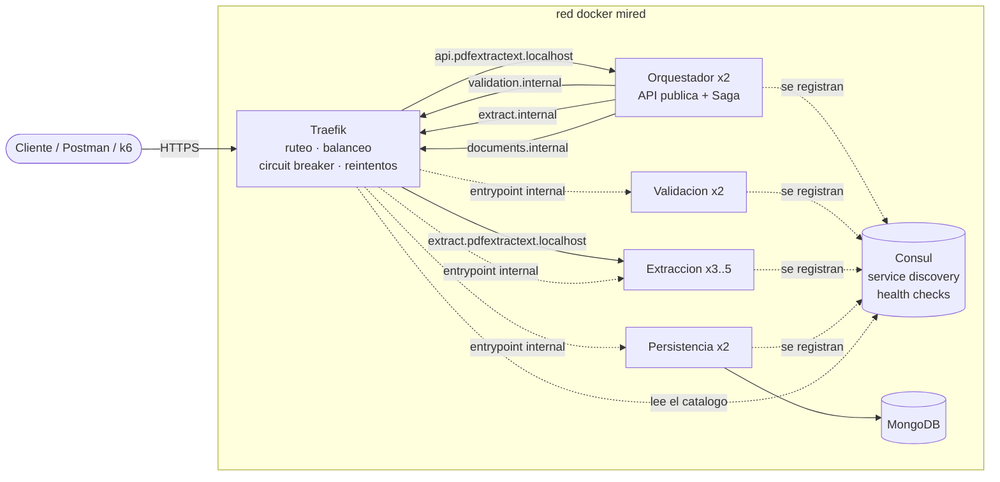

# pdf-extractext-deploy

Infraestructura y despliegue de **PDF-extractext** con microservicios. Levanta el sistema completo con una sola línea: Traefik, Consul, MongoDB y los cuatro microservicios.

Proyecto de la materia **Desarrollo de Software**, UTN Facultad Regional San Rafael, 2026 (Etapa 2).

## Arquitectura



| Servicio | Repo | Rol |
|---|---|---|
| Orquestador | [`pdf-extractext-orchestrator`](../pdf-extractext-orchestrator) | API pública y Saga de subida |
| Validación | [`pdf-validation-service`](../pdf-validation-service) | Formato, tamaño, lectura y checksum |
| Extracción | [`pdf-extract-service`](../pdf-extract-service) | Markdown o texto; microservicio del TP de carga |
| Persistencia | [`pdf-extractext`](../pdf-extractext) | MongoDB, CRUD y reservas de la Saga |

- Cada réplica se **registra sola en Consul** al arrancar, con un ID único, un health check HTTP y los tags que Traefik necesita para crear sus routers. Al apagarse se da de baja.
- **Traefik** lee el catálogo de Consul y balancea solo entre instancias sanas. Aplica **circuit breaker** y **reintentos** a cada servicio.
- Las llamadas entre servicios también pasan por Traefik: los nombres `*.internal` son alias de red del contenedor de Traefik y entran por un entrypoint interno (`:8000`) que no se publica en el host.
- Los contratos de cada servicio están en [`docs/CONTRATOS.md`](docs/CONTRATOS.md).

## Requisitos

- Docker con Compose v2.
- [mkcert](https://github.com/FiloSottile/mkcert#installation) para los certificados HTTPS locales.
- Los cinco repos clonados uno al lado del otro:

```
proyecto/
├── pdf-extractext-deploy/        <- este repo
├── pdf-extractext-orchestrator/
├── pdf-validation-service/
├── pdf-extract-service/
└── pdf-extractext/
```

## Cómo levantarlo

La primera vez, dar permiso de ejecución a los scripts (git guarda ese permiso al commitear):

```bash
chmod +x scripts/*.sh
./scripts/up.sh
```

El script:

1. Verifica que estén los repos.
2. Crea `.env` desde `.env.example` (después conviene cambiar la clave de Mongo).
3. Crea la red `mired` si no existe.
4. Genera los certificados con mkcert si no existen.
5. Hace `docker compose up -d --build`.

| URL | Qué es |
|---|---|
| `https://api.pdfextractext.localhost/docs` | API pública (Swagger) |
| `https://extract.pdfextractext.localhost/docs` | Extracción (TP de carga) |
| `https://traefik.pdfextractext.localhost/dashboard/` | Dashboard de Traefik |
| `https://consul.pdfextractext.localhost/ui/` | UI de Consul |

Si algún cliente no resuelve `*.localhost`, agregar a `/etc/hosts`:

```
127.0.0.1 api.pdfextractext.localhost extract.pdfextractext.localhost traefik.pdfextractext.localhost consul.pdfextractext.localhost
```

Otros comandos:

```bash
./scripts/logs.sh orchestrator          # logs de un servicio (se ve cada paso de la saga)
./scripts/down.sh                       # bajar todo
./scripts/down.sh --volumes             # bajar y borrar los datos
docker compose up -d --scale extract=5  # escalar un servicio
```

## Pruebas

| Prueba | Cómo |
|---|---|
| Punta a punta con curl | `./scripts/smoke.sh ruta/al.pdf` |
| Punta a punta con Postman | Importar `postman/pdf-extractext.postman_collection.json` y correr la colección en orden |
| Spike con k6 | `./scripts/stress-k6.sh` |
| Carga fija con Vegeta | `./scripts/stress-vegeta.sh` (por defecto 50 req/s durante 30 s) |
| Vulnerabilidades | `./scripts/scan.sh` (Trivy) o `SCANNER=grype ./scripts/scan.sh` |

Las pruebas de carga usan los PDFs de `tests/stress/pdfs/`. Mientras no estén los oficiales de la cátedra, `./scripts/generate-sample-pdfs.sh` genera cuatro de prueba. Los resultados quedan en `tests/stress/results/`.

## Configuración

Todo se configura en `.env` (ver `.env.example`):

| Variable | Por defecto | Descripción |
|---|---|---|
| `DOMAIN` | `pdfextractext.localhost` | Dominio de los hosts públicos |
| `MONGO_ROOT_USERNAME` / `MONGO_ROOT_PASSWORD` | — | Credenciales de MongoDB (obligatorias) |
| `*_VERSION` | `1.0.0` | Versión semver de cada imagen |
| `*_REPLICAS` | 2 (extract 3) | Réplicas por servicio; el TP de carga permite hasta 5 en extract |
| `EXTRACT_CPUS` / `EXTRACT_MEMORY` | `1.0` / `1G` | Límite de recursos por réplica de extract |
| `EXTRACT_WORKERS` / `EXTRACT_MAX_IN_FLIGHT` | `1` / `8` | Procesos de extracción y límite de backpressure |
| `RESERVATION_TTL_SECONDS` | `300` | Vida de una reserva de la Saga sin confirmar |
| `TRAEFIK_RETRY_ATTEMPTS` / `TRAEFIK_RETRY_INTERVAL` | `3` / `100ms` | Middleware de reintentos |

## Qué pasa cuando algo falla

| Situación | Comportamiento |
|---|---|
| Una réplica se cae | Su health check en Consul pasa a `critical` y Traefik deja de mandarle tráfico. Al minuto Consul la borra del catálogo. |
| Una réplica se apaga con `docker compose stop` | Se da de baja de Consul antes de cerrar (apagado ordenado). |
| Un servicio responde muchos 5xx o errores de red | El circuit breaker de Traefik corta y responde 503 enseguida hasta que se recupere. |
| Error de conexión momentáneo | Reintentan Traefik (middleware `retry`) y el cliente httpx del orquestador. |
| Falla la extracción en medio de una subida | La Saga compensa: libera la reserva en persistencia y el cliente recibe 503. |
| El orquestador se cae en medio de una subida | La reserva queda `pending` y el índice TTL de Mongo la borra cuando vence. |
| Extract saturado | Responde 503 con `Retry-After` en vez de encolar (backpressure). |

## Equipo

Fabio, Luciana y Celina.

## Licencia

MIT, ver [LICENSE](LICENSE).
