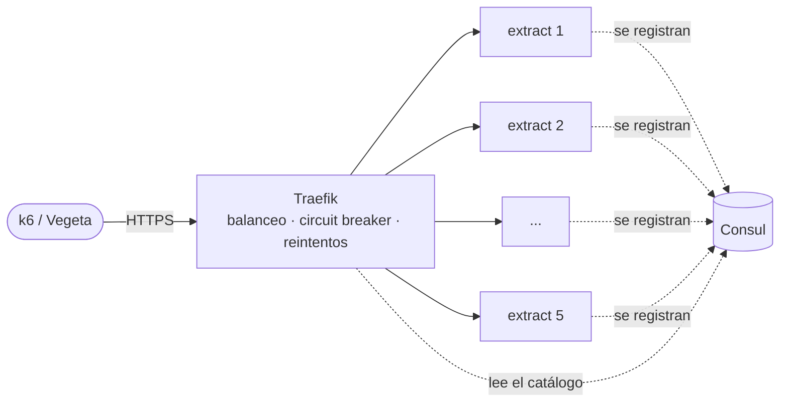
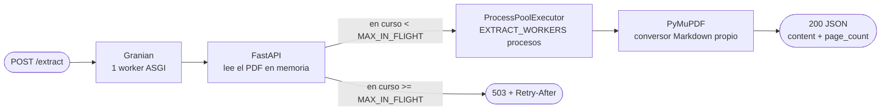

# Informe del TP de carga y estrés: microservicio de extracción

Proyecto PDF-extractext, Desarrollo de Software, UTN Facultad Regional San Rafael, 2026.
Microservicio evaluado: [`pdf-extract-service`](https://github.com/luciana208/pdf-extract-service), endpoint `POST /extract`.

## 1. Resumen

Con la misma configuración y el mismo código, medimos en dos máquinas. En las dos, la mejora respecto de la versión inicial es de un orden de magnitud. En la máquina con más núcleos el servicio supera la referencia de la cátedra en Vegeta y la iguala o supera en k6.

| | k6: requests | k6: éxito | k6: throughput | k6: p50 / p95 | Vegeta: éxito | Vegeta: throughput | Vegeta: p50 | Vegeta: timeouts |
|---|---|---|---|---|---|---|---|---|
| Antes de optimizar (máquina A) | 7959 | 0,63 % | 1,25 OK/s | 4,83 / 27,6 s | 2,67 % | 0,73/s | 2 ms (rechazos) | 2 |
| Después (máquina A) | 687 | **100 %** | 17,2 OK/s | 4,05 / 10,9 s | 48,5 % | 14,6/s | 0,67 s | 19 |
| **Después (máquina B, promedio de 3)** | **1059** | **100 %** | **24,9/s (k6) · 26,5/s en 40 s** | 2,64 / **7,63 s** | **73,4 %** | **25,0/s** | **6,8 s** | **0** |
| Referencia de la cátedra | 1037 | 100 % | 25,35/s | **1,88** / 8,80 s | 66,5 % | 16,65/s | 14,9 s | 501 |

- **Máquina A:** Intel Core i5 de 4.ª generación, 4 núcleos, 15 GB de RAM.
- **Máquina B:** AMD Ryzen 7 7435HS, 8 núcleos y 16 hilos, 15 GB de RAM.

Los cambios con mayor impacto, en orden:
1. Reemplazar la conversión a Markdown de `pymupdf4llm` por un conversor propio, entre 18 y 30 veces más rápido.
2. Sacar los 503 del backpressure de la expresión del circuit breaker.
3. Pasar de rechazar a encolar, con un límite calculado a partir del timeout.

## 2. Arquitectura de la solución



Dentro de cada réplica:



Decisiones de diseño:

| Decisión | Por qué |
|---|---|
| **Python 3.14, FastAPI y Granian** | Granian es un servidor ASGI en Rust con poco overhead por request. Host, puerto y workers se configuran por variables de entorno (Twelve-Factor III y VII). |
| **Pool de procesos separado del runtime HTTP** (punto 5.4 de la consigna) | La extracción usa CPU. Si corriera en el event loop, un PDF de 150 páginas bloquearía todas las demás requests. Con `ProcessPoolExecutor`, el proceso HTTP sigue atendiendo, y los health checks y los rechazos responden al instante. |
| **PDF en memoria, sin disco** (punto 5.1) | El umbral de spool de Starlette está subido al tamaño máximo, así que el multipart no se escribe en un archivo temporal. |
| **Backpressure con límite de requests en curso** (punto 5.2) | Si hay `MAX_IN_FLIGHT` extracciones en curso o en cola, la siguiente recibe `503` con `Retry-After` al instante. El límite se calcula para que ninguna request encolada supere el timeout del cliente. |
| **5 réplicas detrás de Traefik, descubiertas por Consul** (punto 5.3) | Cada réplica se registra sola con sus tags de Traefik. Traefik balancea entre las sanas y aplica circuit breaker y reintentos. |
| **Límites por contenedor** | `cpus: 1.0` y `memory: 1G` en el compose, como pide la consigna. |
| **Conversor Markdown propio sobre PyMuPDF** | Ver la sección 5: es el cambio de mayor impacto. |

## 3. Entorno y metodología

- **Despliegue:** `pdf-extractext-deploy`, con `./scripts/up.sh` (o `docker compose up -d --build`). Todo corre en Docker: Traefik v3.5, Consul y las réplicas de extracción.
- **Scripts de prueba:**
  - `scripts/stress-k6.sh` corre `tests/stress/k6/spike.js`: spike de 0 a 100 VUs en 10 s, 20 s sostenidos y bajada en 10 s. Es un modelo cerrado, timeout de 30 s, rotando los 4 PDFs.
  - `scripts/stress-vegeta.sh` corre una carga fija de 50 req/s durante 30 s (1500 requests). Es un modelo abierto, timeout de 30 s, rotando los 4 PDFs.
- **PDFs de prueba:** todavía no tenemos la carpeta oficial de la cátedra, así que `scripts/generate-sample-pdfs.sh` genera cuatro de densidad variable: `liviano` (2 páginas, 23 KB), `mediano` (30 páginas, 0,3 MB), `pesado` (150 páginas, 1,7 MB) y `graficos` (18 páginas con figuras e imágenes, 9,3 MB). Cuando estén los oficiales, alcanza con copiarlos a `tests/stress/pdfs` y repetir las corridas.
- **Las dos pruebas corren contra extract por HTTPS a través de Traefik**, igual que un cliente real.
- **Cada corrida arranca con Traefik reiniciado.** El circuit breaker conserva el estado de la corrida anterior (sección 4.2), así que sin reiniciar una medición contaminaría a la siguiente.
- En las dos máquinas, k6, Vegeta, Traefik y las réplicas comparten el mismo host.

## 4. Medición base y diagnóstico

### 4.1. Configuración inicial

- 3 réplicas, 1 proceso de extracción cada una y `MAX_IN_FLIGHT` 8.
- Markdown con `pymupdf4llm`, ya sin motor de layout, sin OCR, sin imágenes, sin gráficos y sin tablas.
- Circuit breaker con `NetworkErrorRatio() > 0.5 || ResponseCodeRatio(500, 600, 0, 600) > 0.5`.

| Prueba | Requests | Éxito | Detalle |
|---|---|---|---|
| k6 | 7959 | 0,63 % (50 OK) | Exitosas: mediana de 4,83 s, p95 de 27,6 s. Todas: mediana de 72 ms. |
| Vegeta | 1500 | 2,67 % (40 OK) | 1458 × 503 con mediana de 2 ms, y 2 timeouts. |

### 4.2. Diagnóstico del problema inicial

1. **Cascada entre backpressure y circuit breaker.** Con 100 usuarios y 3 réplicas de 8 lugares, extract rechaza el exceso con 503. Pero el breaker contaba esos 503 como errores del servicio: superaban el 50 % de 5xx, se abría y desde ahí Traefik rechazaba **todo** en unos 2 ms sin reenviar nada. En k6 cada usuario rechazado reintenta al instante, lo que explica las 7959 requests, casi todas fallidas en milisegundos.
2. **El circuit breaker queda trabado.** Una hora después de la prueba, un PDF suelto seguía recibiendo 503 en 6 ms, y los logs de extract no mostraban ningún request. Traefik registraba `CircuitBreaker(state=recovering, …) is in error state`. El breaker solo se reevalúa cuando llega un request, y lo hace con las estadísticas que quedaron de la tormenta. Con tráfico bajo no se recupera nunca. Se destrabó al reiniciar Traefik. Por eso la medición de Vegeta se repitió con Traefik limpio (el primer intento dio 1,93 %) y a partir de ahí cada corrida arranca con Traefik reiniciado.
3. **Aun sin cascada, la capacidad era de ~1 extracción por segundo.** Lo confirmó la primera corrida después de arreglar el breaker (R1, sección 6). Medimos el costo de cada PDF solo, en serie:

| PDF | Markdown (`pymupdf4llm`) | Texto plano |
|---|---|---|
| liviano (2 pág.) | 0,13 s | 0,01 s |
| mediano (30 pág.) | 1,73 s | 0,06 s |
| pesado (150 pág.) | **10,09 s** | 0,27 s |
| gráficos (18 pág.) | 0,33 s | 0,07 s |
| **Promedio** | **3,07 s** | **0,10 s** |

Medido en la máquina A, con requests HTTP una a la vez. Con un promedio de 3 s de CPU por PDF y 3 CPUs, el techo teórico es de 1 extracción por segundo, justo lo que medían k6 y Vegeta. Ninguna combinación de réplicas o colas podía arreglarlo. Para llegar a los ~25 req/s de la referencia hacía falta un costo promedio de unos 0,2 s por PDF.

La consigna exige Markdown, así que medir en texto plano no era una opción. El problema estaba en cómo se generaba el Markdown.

## 5. Cuello de botella: la conversión a Markdown

Perfilamos `pymupdf4llm.to_markdown` con `cProfile` sobre el PDF mediano (30 páginas, 1,6 s):

| Función | Tiempo | Qué hace |
|---|---|---|
| `page_get_textpage` (60 llamadas) | 0,75 s (47 %) | Arma la estructura de texto de cada página **dos veces**, con opciones caras |
| `column_boxes` / `can_extend` | 0,55 s (34 %) | Detecta columnas: compara rectángulos de a pares |
| `get_bg_color`, `get_pixmap` | 0,13 s | Rasteriza para detectar fondos |

Más del 80 % del tiempo se iba en tareas que no necesitábamos: no usamos columnas, y tablas, imágenes y gráficos ya estaban apagados.

**Solución:** un conversor propio de 50 líneas, [`app/data/extractors/markdown_writer.py`](https://github.com/luciana208/pdf-extract-service/blob/main/app/data/extractors/markdown_writer.py):
- Lee cada página **una sola vez** con `page.get_text("dict")` de PyMuPDF.
- Toma como cuerpo el tamaño de letra con más texto, y los tres tamaños mayores pasan a ser títulos `#`, `##` y `###`.
- Cada bloque de texto es un párrafo.

Se desarrolló con TDD: 5 tests de títulos, párrafos, documentos sin títulos y PDFs vacíos.

| PDF | `pymupdf4llm` | Conversor propio | Mejora |
|---|---|---|---|
| liviano | 0,076 s | 0,009 s | 8× |
| mediano | 1,101 s | 0,056 s | 20× |
| pesado | 5,701 s | 0,282 s | 20× |
| gráficos | 0,283 s | 0,029 s | 10× |
| **Promedio** | **1,79 s** | **0,094 s** | **19×** |

Medido en serie, llamando directo a la función, en una máquina de desarrollo de 2 núcleos con la misma versión de PyMuPDF (2.1).

**Limitación del conversor:** el conversor no reconoce columnas, listas ni tablas. Tablas y gráficos ya estaban desactivados en `pymupdf4llm` por costo, así que la salida es equivalente para nuestros PDFs: títulos y párrafos. Es un compromiso explícito entre calidad de Markdown y CPU, en línea con el punto 5.1 de la consigna. El formato `text` sigue disponible y no cambió.

## 6. Proceso de optimización

Cada fila cambia **una sola cosa** respecto de la anterior. Se midió en la máquina A, con Traefik reiniciado antes de cada prueba.

| # | Cambio | k6 req | k6 éxito | k6 OK/s | k6 p50 / p95 | Vegeta éxito | Vegeta thr. | Códigos Vegeta |
|---|---|---|---|---|---|---|---|---|
| Antes | Configuración inicial | 7959 | 0,63 % | 1,25 | 4,83 / 27,6 s | 2,67 % | 0,73/s | 200: 40 · 503: 1458 · 0: 2 |
| R1 | El breaker no cuenta los 503 | 2080 | 2,26 % | 1,18 | 13,8 / 26,7 s | 1,20 % | 0,35/s | 200: 18 · 503: 1460 · 0: 22 |
| R2 | Conversor Markdown propio | 1873 | 10,6 % | 4,97 | 5,86 / 15,9 s | 20,1 % | 9,37/s | 200: 302 · 503: 1198 |
| R3 | `MAX_IN_FLIGHT` 8 → 35 | 690 | 91,5 % | 15,8 | 5,74 / 8,88 s | 28,5 % | 11,8/s | 200: 427 · 503: 1073 |
| R4 | 3 → 4 réplicas | 716 | 97,6 % | 17,5 | 4,53 / 9,26 s | 32,3 % | 12,8/s | 200: 484 · 503: 1016 |
| R5 | `MAX_IN_FLIGHT` 35 → 70 | 714 | 100 % | 17,9 | 3,16 / 14,1 s | 42,1 % | 13,4/s | 200: 632 · 503: 865 · 0: 3 |
| R6 | 4 → 5 réplicas | 725 | 100 % | 18,1 | 3,94 / 12,1 s | 45,7 % | 13,4/s | 200: 685 · 503: 785 · 0: 30 |
| **R7** | `EXTRACT_WORKERS` 1 → 2 | 681 | 100 % | 17,0 | 3,97 / 11,9 s | **49,5 %** | **15,2/s** | 200: 742 · 503: 755 · 0: 3 |
| R8 | `GRANIAN_WORKERS` 1 → 2 (con `EXTRACT_WORKERS` 1) | 646 | 100 % | 16,2 | 4,57 / 12,6 s | 46,7 % | 11,7/s | 200: 700 · 503: 425 · **0: 375** |
| FINAL | Configuración de R7, repetida | 687 | 100 % | 17,2 | 4,05 / 10,9 s | 48,5 % | 14,6/s | 200: 727 · 503: 754 · 0: 19 |

"k6 OK/s" son las requests exitosas divididas por los 40 s del perfil. "0" son los timeouts de cliente de 30 s.

Análisis de cada paso:

- **R1, el breaker:** desaparece la cascada. Los 503 tardan unos 20 ms en vez de 2 ms, o sea que ahora los rechaza extract y no Traefik. Pero la cantidad de éxitos no cambia, y eso confirmó que el límite era la CPU, no la configuración (sección 4.2).
- **R2, el conversor:** la capacidad útil se multiplica por 4 en k6 y por 13 en Vegeta. Los timeouts desaparecen. Lo que queda son rechazos del backpressure.
- **R3 y R5, de rechazar a encolar:** con cola de 8, extract rechazaba trabajo que hubiera terminado antes del timeout. Cada réplica procesa unas 3,2 extracciones por segundo en la máquina A. Con un margen de unos 20 s antes del timeout de 30 s, puede tener unas 70 en cola sin que ninguna venza. Con 5 × 70 aparecen los primeros timeouts en la máquina A, así que 70 es el techo para este hardware. En k6 el cambio es decisivo: 100 usuarios entran en la cola y no hay ningún rechazo.
- **R4 y R6, réplicas:** la quinta réplica ayuda un poco aunque la máquina A tenga solo 4 núcleos. No todo el tiempo de una réplica es CPU de extracción: también recibe la subida, parsea el multipart y copia al pool.
- **R7, 2 procesos de extracción por réplica:** k6 queda igual, dentro del ruido entre corridas, y Vegeta mejora unos 4 puntos. Mientras un proceso espera el siguiente PDF, el otro trabaja, así que se aprovechan mejor los ratos en que la CPU queda libre dentro del límite de 1 CPU.
- **R8, 2 workers de Granian: empeora.** Cada worker de Granian es un proceso con su propio contador de requests en curso, así que la cola real por réplica se duplica (2 × 70). Las esperas pasan los 30 s y aparecen 375 timeouts. Conclusión: el límite de cola tiene que ser uno solo por réplica, y por eso Granian queda con 1 worker.

## 7. Configuración final

En `docker-compose.yml` (valores por defecto) y en `.env.example`:

| Variable | Valor | Motivo |
|---|---|---|
| `EXTRACT_REPLICAS` | 5 | Máximo permitido por la consigna |
| `EXTRACT_CPUS` / `EXTRACT_MEMORY` | 1.0 / 1G | Límites de la consigna |
| `EXTRACT_WORKERS` | 2 | Procesos de extracción por réplica (R7) |
| `EXTRACT_GRANIAN_WORKERS` | 1 | Un solo contador de cola por réplica (R8) |
| `EXTRACT_MAX_IN_FLIGHT` | 70 | Capacidad por réplica × margen hasta el timeout (R5) |
| `EXTRACT_CB_EXPRESSION` | `NetworkErrorRatio() > 0.5 \|\| ResponseCodeRatio(500, 503, 0, 600) > 0.5` | El 503 del backpressure no abre el breaker (R1) |

Más el conversor Markdown propio en `pdf-extract-service`.

## 8. Resultados finales y comparación con la referencia

### Máquina A (i5 de 4.ª generación, 4 núcleos)

Ver la fila FINAL de la sección 6: en k6, 100 % de éxito, 17,2 OK/s y p95 de 10,9 s; en Vegeta, 48,5 % de éxito y 14,6 req/s.

### Máquina B (Ryzen 7 7435HS, 16 hilos): misma configuración, 3 corridas

| Corrida | k6 req | k6 éxito | k6 rate (k6) | k6 OK/40 s | k6 p50 / p95 | Vegeta éxito | Vegeta thr. | Vegeta p50 / p95 | Códigos Vegeta |
|---|---|---|---|---|---|---|---|---|---|
| 1 | 1064 | 100 % | 24,7/s | 26,6 | 2,29 / 8,33 s | 77,0 % | 26,7/s | 5,52 / 13,9 s | 200: 1155 · 503: 345 |
| 2 | 1054 | 100 % | 24,6/s | 26,4 | 2,77 / 8,10 s | 70,0 % | 24,3/s | 8,23 / 14,8 s | 200: 1050 · 503: 450 |
| 3 | 1060 | 100 % | 25,5/s | 26,5 | 2,87 / 6,45 s | 73,2 % | 24,0/s | 6,57 / 15,4 s | 200: 1098 · 503: 402 |
| **Promedio** | **1059** | **100 %** | **24,9/s** | **26,5** | **2,64 / 7,63 s** | **73,4 %** | **25,0/s** | **6,77 / 14,7 s** | 200: ~1101 · 503: ~399 · **0: 0** |
| Referencia | 1037 | 100 % | 25,35/s | 25,9 | 1,88 / 8,80 s | 66,5 % | 16,65/s | 14,9 s / — | 200: 998 · 0: 501 |

**Vegeta (modelo abierto):** el servicio supera la referencia en las tres corridas.
- Más éxito: 73,4 % contra 66,5 %.
- Un 50 % más de throughput: 25,0 contra 16,65 req/s.
- Mediana de 6,8 s contra 14,9 s.
- **Ningún timeout**, contra 501.

La diferencia está en cómo se maneja la congestión. La referencia deja crecer la cola hasta que un tercio de las requests vence. Acá lo que no entra en la cola se rechaza enseguida con 503 y `Retry-After`, y todo lo que se acepta termina antes del timeout. Es lo que plantea la nota técnica de la consigna.

**k6 (modelo cerrado):**
- Procesa más requests que la referencia (1059 contra 1037), con 0 % de error y mejor p95 (7,6 contra 8,8 s).
- La mediana es peor (2,6 contra 1,9 s).
- El throughput que informa k6 divide por la duración total de la prueba, unos 42–43 s porque incluye el cierre de las requests en cola. Así da 24,9/s de promedio, con una corrida de 25,5/s. Si se divide por los 40 s del perfil, como en "1037 peticiones en 40 segundos", da 26,5/s.

**Diferencia entre máquinas:** el código y la configuración son idénticos. En la máquina A, las 5 réplicas limitadas a 1 CPU, Traefik (que cifra con TLS unos 4,4 GB en la prueba de Vegeta, porque el PDF de gráficos pesa 9,3 MB), k6 y Vegeta compiten por 4 núcleos, así que las réplicas nunca llegan a tener 1 CPU entera. En la máquina B sí la tienen. Los límites de la consigna son por contenedor, y en la máquina B se cumplen de verdad.

## 9. Limitaciones y trabajo futuro

- **PDFs de prueba:** son generados, no la carpeta oficial de la cátedra. Los números absolutos pueden cambiar con los oficiales. El procedimiento y la configuración no.
- **Rechazo después de recibir el PDF:** hoy el 503 del backpressure se decide cuando el PDF ya se recibió completo, así que cada rechazo igual consume subida, TLS y parseo. Rechazar antes de leer el body liberaría CPU en Vegeta.
- **Mediana de k6:** con 100 usuarios en cola, la mediana depende de cuánto espera cada request. Una cola más corta la bajaría, a costa de rechazar en k6.
- **Circuit breaker de Traefik:** su recuperación depende del tráfico (sección 4.2). En producción conviene monitorearlo o usar expresiones con ventanas más cortas.
- **Calidad del Markdown:** el conversor no reconoce columnas, listas ni tablas. Si hicieran falta, habría que agregarlas solo para documentos chicos o con un formato aparte.

## 10. Cómo reproducir

```bash
# los cinco repos clonados uno al lado del otro; mkcert y uv instalados
cd pdf-extractext-deploy
./scripts/up.sh                      # levanta todo con la configuración final
./scripts/generate-sample-pdfs.sh    # o copiar los PDFs oficiales a tests/stress/pdfs
./scripts/stress-k6.sh               # spike de k6 -> tests/stress/results/k6-summary.json
docker restart pdf-traefik           # estado limpio del circuit breaker entre pruebas
./scripts/stress-vegeta.sh           # carga fija -> tests/stress/results/vegeta-report.json y vegeta-plot.html
```

Para repetir la medición base, en `.env`: `EXTRACT_REPLICAS=3`, `EXTRACT_WORKERS=1`, `EXTRACT_MAX_IN_FLIGHT=8` y `EXTRACT_CB_EXPRESSION="NetworkErrorRatio() > 0.5 || ResponseCodeRatio(500, 600, 0, 600) > 0.5"`. Después, `docker compose up -d extract`. El conversor anterior está en el historial de `pdf-extract-service`, antes del commit `perf(verde): conversor markdown propio sobre get_text dict (E8)`.
